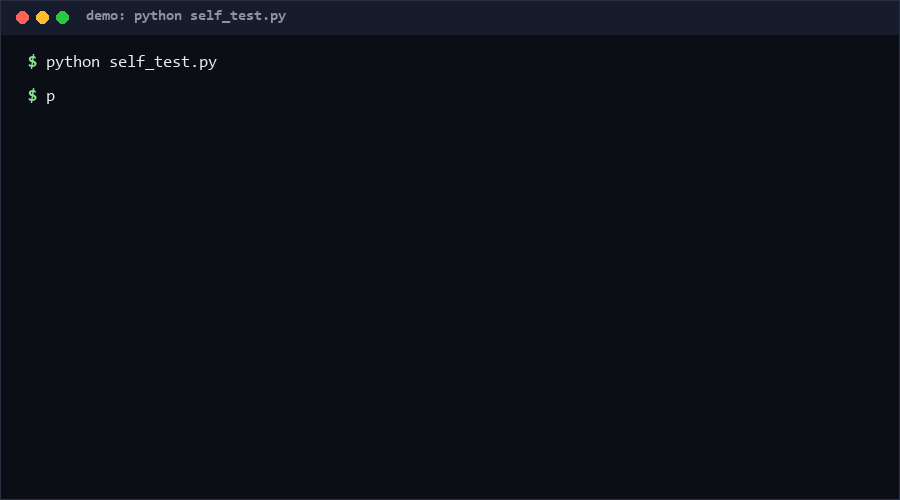

# osint-source-catalog

A curated catalog of public, legally servable data sources — each annotated with license, rate limits, auth mode, and a three-level compliance grade — plus a pre-audit tool that flags licensing conflicts in an aggregation plan *before* you write code. If you build aggregators or OSINT dashboards and want compliance decided at design time, not in legal hindsight, use this.

**Confidence: High (80%)** that pre-auditing at design time prevents the most common aggregation-license conflicts; the grades themselves are [estimated] and dated.

<p align="center"></p>

## Problem

Free public data sources make aggregators deceptively easy — until redistribution rights, rate etiquette, and privacy-adjacent misuse surface late.

- **Why novel:** the value of OSINT aggregation is in the *facade* — combining free sources into a paid-intelligence experience. But every source has different terms, and nobody pre-checks them; this catalog makes the check mechanical.
- **Overlooked angle:** the privacy paradox. Twelve individually-compliant public feeds can aggregate into surveillance-grade capability. The legal/ethical boundary of the *combination* is discussed almost nowhere — so this repo forces the question at plan time via compliance levels.

## How it works

Each catalog entry carries: `license`, `rate_limit {requests, per}`, `auth` (none / api_key / registration), `compliance_level`:

| Level | Meaning | Public aggregation | Redistribution |
|---|---|---|---|
| **A** | open license + documented ToS | OK | OK |
| **B** | open with attribution / identity etiquette | OK | OK with attribution |
| **C** | public but ToS-gray for aggregation | **REVIEW required** | **BLOCK** |

`preaudit` takes a plan (`{"sources": [...], "use": "internal|aggregate-public|redistribute"}`) and returns per-source verdicts plus an overall PASS / REVIEW / REJECT. Shipped catalog: 12 sources as of 2026-09-20 (weather, seismic, geospatial, finance, news, science, web) — e.g. Open-Meteo (A), OSM Nominatim (B), live aircraft tracking mirrors (C).

## Quickstart (~2 min)

```bash
# 1. Validate the shipped catalog (~2 s)
python cli.py validate

# 2. Browse / filter sources (~2 s)
python cli.py list --level C            # the gray-zone ones
python cli.py show open-meteo

# 3. Pre-audit a plan (~2 s)
python cli.py preaudit examples/plan_clean.json    # -> PASS
python cli.py preaudit examples/plan_risky.json    # -> REVIEW, exit 1
```

Fully offline, pure standard library. Start with the two `preaudit` examples — they encode the whole decision model.

## Why not X

| Alternative | Why not |
|---|---|
| Read each ToS yourself ad hoc | Non-reproducible, forgettable, and nobody re-checks when a project pivots; the audit is a machine-checked gate |
| Generic license databases (FOSS scanning) | Cover code licenses, not data ToS + rate etiquette + privacy-adjacent grades |
| Paid API marketplaces | Solve billing, not compliance grading; and the point of OSINT is zero-key cold start |
| Hardcode source list in your app | Ages instantly, no grades, no pre-audit artifact you can show a reviewer |

## Minimal Fallback (PLAN B)

No Python? `data/sources.json` is plain JSON — sort by `compliance_level` in any editor. The audit logic is 40 lines of if-statements documented in the table above; you can apply it by hand.

## Ethics & Legal Boundaries

- **Scope:** only publicly accessible, legally servable sources are cataloged. No scraping guidance for sources that prohibit it, no paywall circumvention, no credentialed-data access.
- **Privacy paradox is first-class:** level C exists precisely for sources (e.g. live aircraft/vessel tracking) whose *aggregation* creates stalking-capable products. Level C blocks redistribution by construction and mandates ToS review for public aggregation. This tool will not bless surveillance-grade products built from gray-zone sources.
- **Grades are advisory, not legal advice.** Each entry links the source's own terms; the `as_of` date matters — ToS drift is real. You remain responsible for honoring rate limits, attribution, and current terms at query time.
- **Intended use:** research, journalism, civil defense, situational awareness. If your aggregation's main value is monitoring specific individuals, stop — that is outside the design envelope regardless of audit verdict.
- Contact: hcac4735@agent.qq.com

## Design Trade-offs

Priority: **refusal safety > auditability > coverage > freshness.** Three grades, not ten — coarse grades get maintained, fine ones rot. The audit REJECTs on unknown sources rather than assuming innocence (fail-closed). Rate limits are recorded as structured numbers with dates, not prose, so drift is detectable.

## Limits & Second-order Effects

- **Limits:** 12 sources is a seed, not a registry; grades are [estimated] judgments as of 2026-09-20 and can be wrong in either direction; ToS text changes without notice.
- **Second-order effects:** a shared grade could become a rubber stamp ("it passed preaudit") — the audit checks the catalog's model, not the real ToS, so a stale grade propagates false confidence. Conversely, public C-level labeling may pressure sources to clarify their terms, which is the intended second-order good.

## FAQ

**Q: Is passing preaudit legal clearance?**
No. It is a design-time filter that catches obvious license conflicts. REVIEW verdicts require human judgment; even PASS does not exempt you from the ethics note returned with every verdict.

**Q: When you should NOT use this tool**
- Your product's core value is monitoring identified individuals — no audit can make that appropriate.
- You need authoritative legal opinions — hire counsel; this is a heuristic gate.
- You need guaranteed-current rate limits — query the source's own status/docs at runtime.

**Q: Why fail-closed on unknown sources?**
Because aggregation bugs hide in the source you forgot to list. Adding a source to the catalog is cheap; discovering a ToS violation after launch is not. [High confidence: fail-closed defaults dominate fail-open in compliance tooling]

## Core Assumptions

1. A three-level grade captures most of the practical distinction between data-source terms for aggregation projects.
2. Source operators' published ToS and docs are accurate representations of what is permitted (as of each entry's date).
3. Design-time pre-auditing measurably reduces late-stage license conflicts compared to ad-hoc review.
4. Catalog maintainers will re-verify entries periodically; the `as_of` field makes staleness visible.

*Catalog data as of 2026-09-20. Contact: hcac4735@agent.qq.com*
